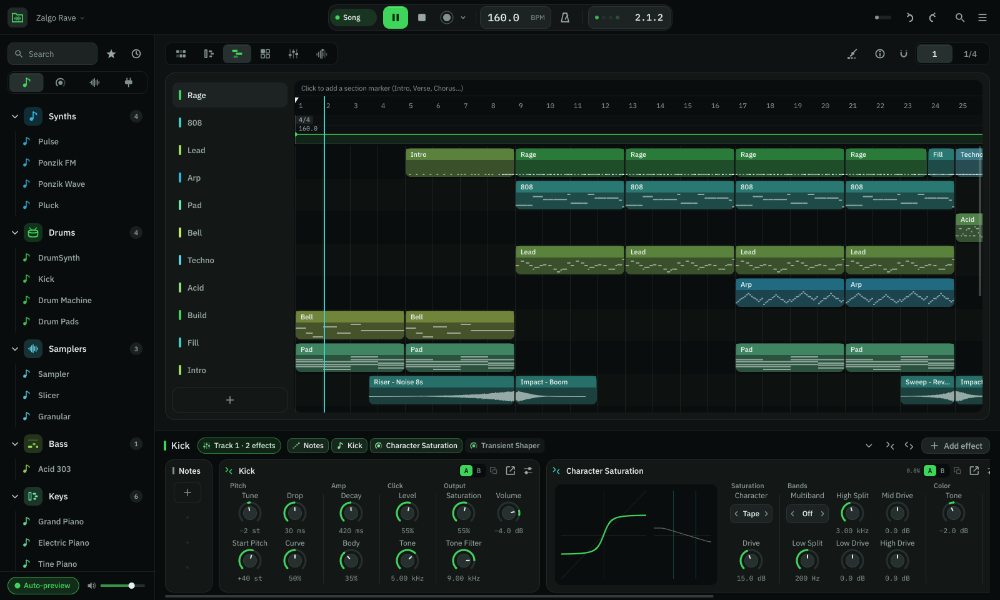

# Ponzik

**The free DAW. FL Studio's breadth, Ableton Live's clarity. No more gatekeeping.**

[Download](https://github.com/nokogoat/ponzik/releases) | [What's inside](docs/OVERVIEW.md) | [Getting started](docs/GETTING_STARTED.md) | [Shortcuts](docs/SHORTCUTS.md) | [Plugins](docs/PLUGINS.md) | [Build](docs/BUILDING.md) | [Contributing](AGENTS.md) | [License](LICENSE)

Ponzik is a complete music studio: beats, sampling, vocals, mixing and mastering, for
beginners and pros alike. It is written from scratch in **100% Rust with zero
dependencies**, from the audio drivers to every instrument, and runs on Linux and
Windows.

> [!IMPORTANT]
> **This is only the beginning.** Ponzik is young and moving fast: expect missing
> pieces, rough edges and the occasional bug. Your projects and feedback help a lot,
> please [open an issue](https://github.com/nokogoat/ponzik/issues) when something
> breaks.

> [!NOTE]
> Ponzik is **free for real**: no editions, no paid upgrades, no account, no
> internet required. Every feature is in the one version you download.

## Highlights

- **FL Studio's workflow**: Channel Rack, piano roll, playlist, the same shortcuts and gestures.
- **Ableton's clarity**: one calm window, Session view, a command palette (Ctrl+K).
- **Real instruments**: modeled grand piano, guitars, strings, organ, electric pianos, synths and drums.
- **Pro tools**: warping, comping, sidechain, CLAP and VST3 plugins, FL Studio project import.
- **Light**: one ~9 MB program that starts instantly and updates itself.

## Project status

Most of FL Studio and Ableton Live's features are in ([comparison](docs/FEATURES.md)),
and the [roadmap](docs/BACKLOG.md) lists what's next.

## License

GPL-3.0-or-later. IBM Plex fonts under the SIL Open Font License.
