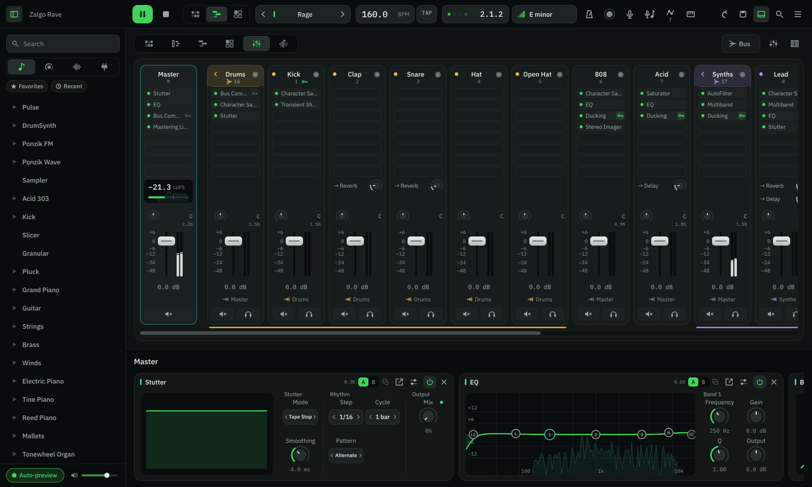
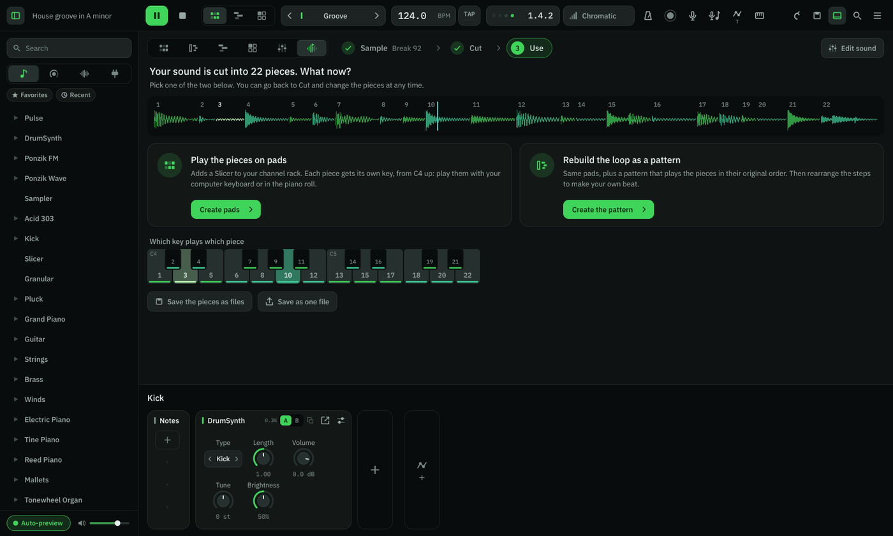
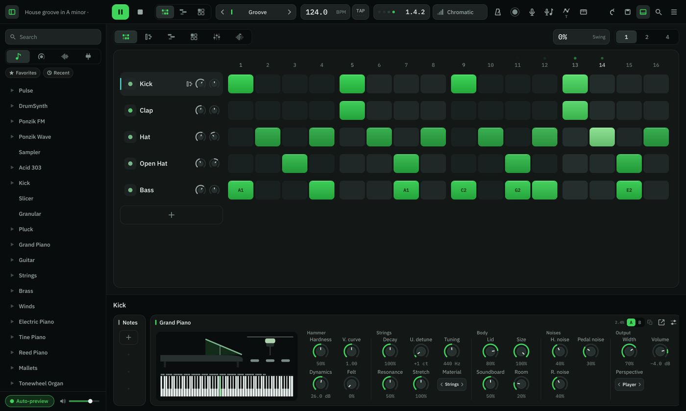

<div align="center">

# Ponzik

**The free DAW. No more gatekeeping.**

FL Studio's breadth, Ableton Live's clarity — free, open source, for everyone.


</div>

---

Ponzik is a complete digital audio workstation for making music: beats, songs,
sampling, recording vocals, mixing and mastering. It is built for beginners and
professionals alike — you can make a beat in thirty seconds, and the full power is
there when you go looking for it.

There are no editions, no paid upgrades, no account and no internet connection
required. Every feature is in the one free version.

And it is built **entirely from scratch in 100% Rust with zero dependencies**: audio
and MIDI drivers, windowing, 2D rendering, fonts, the engine, every instrument and
effect, the plugin hosts and the file codecs. Ponzik only talks to the operating
system.

## Contents

- [Why Ponzik](#why-ponzik)
- [Features](#features)
- [Download](#download)
- [Build from source](#build-from-source)
- [Your first beat](#your-first-beat)
- [Shortcuts](#shortcuts)
- [Plugins](#plugins)
- [Platform support](#platform-support)
- [Architecture](#architecture)
- [Contributing](#contributing)
- [License](#license)

## Why Ponzik

- **Free for real.** Not a trial, not a "lite" edition. Everything, forever.
- **Fast to learn.** FL Studio's gestures and shortcuts, Ableton's calm single-window
  layout, a guided tour on first launch, tooltips on everything, workspace profiles
  (Beatmaker, Sampling, Live, Minimal) that hide what you don't use, and a
  do-anything command palette (Ctrl+K).
- **Deep when you need it.** Racks with macros, modulators, warping, comping,
  sidechain, latency compensation, freeze, MIDI learn, live automation, 999 mixer
  tracks, CLAP and VST3 plugins.
- **Sounds good out of the box.** Physically modeled pianos, guitars, strings and
  organs, a generated sound library with 128 sounds and loops, and 400+ factory
  presets — no downloads.
- **Light.** A single ~9 MB program that starts instantly and plays a full demo song
  with about 10 % of one CPU core and well under 100 MB of RAM.
- **Linux is a first-class citizen**, alongside Windows (macOS is in progress).

## Features

<table>
<tr><td width="50%"></td>
<td width="50%"></td></tr>
<tr><td></td>
<td></td></tr>
</table>

### Make music

- **Channel Rack** step sequencer with swing, per-step chance, conditions and
  ratchets, like FL Studio.
- **Piano roll** with scale snapping, a chord grid (shapes, inversions, voicings),
  slide notes, per-note pan and fine pitch, controller lanes (pitch bend, CCs,
  parameters), chord names, MIDI tools (arpeggiate, strum, flam, legato, invert,
  quantize with swing, humanize) and generators (Euclidean rhythms, drum patterns,
  melodies, chord progressions, basslines that follow the chords).
- **Playlist** with patterns, audio clips and automation, section markers (Intro,
  Drop…) you can move and duplicate, tempo changes and ramps, time signatures, take
  comping for vocals.
- **Session view** (Ableton-style clip launcher) with launch modes, quantization,
  follow actions and recording into the arrangement.
- **Hum to play**: sing a note and the selected instrument plays it in real time,
  snapped to your scale, and writes it into the piano roll.
- **Groove pool**, key detection, MIDI capture (Ctrl+Shift+C keeps what you just
  played even if you weren't recording).

### Sounds

- **23 native instruments**, including physically modeled **Grand Piano** (hammers,
  strings, soundboard, sympathetic resonance, real pedals), **Guitar** (steel, nylon,
  electric with amp, bass), **Strings**, **Brass**, **Winds**, **Tine Piano**
  (Rhodes-style), **Reed Piano** (Wurlitzer-style), **Tonewheel Organ** with rotary
  speaker, **Mallets**, plus synths (Pulse, FM, Wavetable, Acid 303, Granular, Pluck),
  drums (Kick, DrumSynth, Drum Machine, **Drum Pads**), Sampler, Slicer and External
  MIDI for hardware synths.
- **31 native effects**: EQ with spectrum, compressors, bus compressor, OTT-style
  multiband, limiters with true peak, gate, transient shaper, pump, ducking, reverbs,
  shimmer, delays, chorus, phaser, rotary speaker, saturators, **Amp & Cab**,
  bitcrusher, noise & texture, stutter, pitch shifter, stereo imager, utility,
  **Rack** (parallel chains with 8 macros) and **Mix Assistant** (listens to a track
  and suggests a chain — it imposes nothing).
- **Note effects** before any instrument: arpeggiator, chord, scale, random, repeat.
- **Modulators** (LFO, envelope follower, step sequencer, random) you drag onto any knob.
- **Sound library** generated by Ponzik itself on first run: kicks, snares, hats,
  808s, plucks, pads, FX and loops at common tempos.

### Sampling and audio

- **Sample Lab**: drop a loop, cut it automatically (or on the beat, or by hand),
  then play the pieces on pads or rebuild the loop as a pattern to flip it.
- **Warp**: audio clips follow the project tempo (Beats, Tones and Re-Pitch modes),
  with warp markers and independent transpose.
- **Drag files from your file manager**: WAV, FLAC, MP3 and Ogg Vorbis.
- Browser with preview (synced to the tempo), favorites, tags and search.

### Record

- **Vocal recording with zero perceptible delay**, no ASIO4ALL needed: input and
  output processed in the same audio cycle, low-latency monitoring, takes aligned
  automatically, loopback latency calibration, punch-in, loop recording with comping.
- MIDI controllers, computer keyboard as a piano, MIDI learn for any control,
  live automation recording (Touch, Latch, Write), count-in, tap tempo.

### Mix and master

- Mixer with up to 999 tracks, buses and VCAs, 8 inserts and 4 sends per track,
  sidechain on every dynamics insert, plugin delay compensation, multi-core
  processing, per-track and per-device CPU meters, A/B on every device.
- Freeze, bounce in place, consolidate, render selection.
- Master LUFS meter and spectrum; export to WAV (16/24/32-bit float) or FLAC, stems,
  one file per section, peak or LUFS normalization.

### Work with others' projects

- **Import FL Studio projects** (`.flp`, up to FL 25): channels, patterns, playlist,
  audio clips, mixer. Missing samples stay in the project and can be relinked in one
  click; FL's factory samples are replaced by library sounds.
- Standard MIDI files in and out; CLAP and VST3 plugins with their own windows and
  saved state.

The full inventory compared with FL Studio and Ableton Live is in
[docs/FEATURES.md](docs/FEATURES.md); what's next is in [docs/BACKLOG.md](docs/BACKLOG.md).

## Download

Ready-to-run builds are published on the
[Releases page](https://github.com/nokogoat/ponzik/releases):

- **Linux**: `Ponzik-x86_64.AppImage` — make it executable and run it.
- **Windows**: `Ponzik.exe` or the portable zip.

Ponzik checks for updates at startup and can install them for you (Settings).
See [docs/INSTALL.md](docs/INSTALL.md) for details.

## Build from source

You need a Rust toolchain (1.85 or newer, edition 2024). On Linux you also need the
ALSA library (`alsa-lib`, or `libasound2-dev` on Debian and Ubuntu). There is nothing
else to install.

```sh
git clone https://github.com/nokogoat/ponzik
cd ponzik
cargo run --release              # opens Ponzik on the house demo
```

Other commands:

```sh
cargo run --release -- breakcore                     # the "Amen rave" demo (180 BPM)
cargo run --release -- zalgo                         # the "Zalgo Rave" demo (160 BPM)
cargo run --release -- render out.wav [morceau|pattern] [breakcore|zalgo]
cargo run --release -- library [dir]                 # generate the sound library
cargo run --release -- screenshot ui.png mixer       # off-screen capture of a view
cargo test                                           # the test suite
```

| Environment variable | Effect |
|---|---|
| `PONZIK_LATENCY_MS` | Audio buffer in milliseconds (2–100, default 10; also in Settings) |
| `PONZIK_LANG` | Interface language (`en`, `fr`), otherwise the one chosen in Settings |
| `CLAP_PATH`, `VST3_PATH` | Extra folders to scan for plugins |

## Your first beat

1. Press **Space**: the demo plays. Press **Ctrl+N** for a new project from a template.
2. In the **Channel Rack** (F6), click steps to light them. Hold the right mouse
   button and sweep to erase.
3. Drag a sound from the browser (left) onto the rack — or drop a WAV/MP3 from your
   file manager.
4. Press **F7** for the piano roll: click to draw notes, drag their end to make them
   longer. Pick a scale in the top bar to stay in key.
5. Press **F5** for the playlist: paint your patterns, drag a loop in and stretch its
   right edge to repeat it.
6. Press **F9** for the mixer, then **Ctrl+R** to export.

The tour on first launch walks through this, and **Ctrl+K** finds any action by name.

## Shortcuts

The same as FL Studio, and every one of them can be remapped in Settings.

| Key | Action |
|---|---|
| Ctrl+K | Command palette: every action in a few keystrokes |
| Space | Play / stop (back to the start marker) |
| F5 · F6 · F7 · F8 · F9 | Playlist · Channel Rack · Piano roll · Sample Lab · Mixer |
| Tab | Next view |
| L | Pattern / song mode |
| R | Arm recording |
| T | Tap tempo |
| F4 | New pattern |
| + / − | Next / previous pattern |
| Alt+F8 · Ctrl+F | Browser · search |
| Ctrl+T | Computer keyboard as a piano |
| Ctrl+M | Metronome |
| Ctrl+Z · Ctrl+Y | Undo · redo |
| Ctrl+N · Ctrl+S · Ctrl+Shift+S · Ctrl+O | New · save · save as · open |
| Ctrl+R | Export |
| Ctrl+C · Ctrl+V · Ctrl+B | Copy · paste · duplicate (notes, clips, time selection) |
| Ctrl+Q | Quantize |
| Ctrl+G | Group mixer tracks into a bus |
| Ctrl+Shift+C | Capture the last phrase you played |
| Ctrl+= · Ctrl+− · Ctrl+0 | Interface size |
| Hold right-click | Erase what you sweep over (steps, notes, clips) |
| Right-click a control | Automate, link to a MIDI controller, reset |

## Plugins

Ponzik hosts **CLAP** and **VST3** plugins (not VST2), with their own interface in a
window, their full state saved in your project, and their latency compensated. It
looks for them in the standard folders:

| Platform | CLAP | VST3 |
|---|---|---|
| Linux | `~/.clap`, `/usr/lib/clap`, `/usr/local/lib/clap` | `~/.vst3`, `/usr/lib/vst3`, `/usr/local/lib/vst3` |
| Windows | `%COMMONPROGRAMFILES%\CLAP`, `%LOCALAPPDATA%\Programs\Common\CLAP` | `%COMMONPROGRAMFILES%\VST3`, `%LOCALAPPDATA%\Programs\Common\VST3` |

Each plugin is loaded once in a separate process, so a broken plugin can't take
Ponzik down; failures are listed at the bottom of the plugin browser. Run
**Rescan plugins** (Ctrl+K) after installing new ones. Native Linux plugins such as
[Surge XT](https://surge-synthesizer.github.io/) and [Vital](https://vital.audio/)
work out of the box.

### Windows plugins on Linux (Serum, ZENOLOGY…)

Windows-only plugins run on Linux through [Wine](https://www.winehq.org/) and
[yabridge](https://github.com/robbert-vdh/yabridge):

1. Install Wine (Wine Staging recommended) and yabridge, e.g.
   `sudo pacman -S wine-staging yabridge yabridgectl`.
2. Install the plugin with its Windows installer: `wine <installer>.exe`, choosing
   the VST3 (or CLAP) format.
3. Bridge it:
   ```sh
   yabridgectl add "$HOME/.wine/drive_c/Program Files/Common Files/VST3"
   yabridgectl sync
   ```
4. Start Ponzik or run **Rescan plugins**: the plugin appears with a VST3 or CLAP badge.

Run `yabridgectl sync` again after installing or updating a Windows plugin.

## Platform support

| Platform | Window | Audio | MIDI |
|---|---|---|---|
| Linux | X11 protocol spoken directly, MIT-SHM, HiDPI (Wayland through XWayland) | ALSA (works with PipeWire and PulseAudio) | ALSA rawmidi, in and out |
| Windows | Win32, per-monitor DPI | WASAPI (low-latency shared mode) | WinMM, in and out |
| macOS (experimental) | Cocoa through the Objective-C runtime | CoreAudio | CoreMIDI |

The interface is in English and French; adding a language is one translation file
(`crates/ponzik-i18n/lang/`).

## Architecture

| Crate | Role |
|---|---|
| `crates/ponzik-dsp` | Allocation-free DSP: oscillators, filters, delays, dynamics, oversampling, FFT, spectrum, loudness, pitch tracking, time-stretching, onset and tempo detection |
| `crates/ponzik-engine` | Real-time engine: sequencing, mixer with PDC and sidechain, automation, clips, Session, multi-core graph, instruments, effects, note effects, codecs (WAV, FLAC, MP3, Ogg Vorbis) |
| `crates/ponzik-project` | Project model and files, sync to the engine, offline rendering, undo, scales and harmony, generators, FL Studio import, sound library, presets |
| `crates/ponzik-audio` | Audio drivers: ALSA, WASAPI, CoreAudio — full-duplex |
| `crates/ponzik-midi` | MIDI drivers: ALSA rawmidi, WinMM, CoreMIDI — input and output |
| `crates/ponzik-window` | Windowing: X11 protocol with MIT-SHM, Win32, Cocoa; plugin windows, file drops, cursors |
| `crates/ponzik-ui` | 2D rendering: anti-aliased rasterizer, TrueType reader, animations, PNG |
| `crates/ponzik-i18n` | Translations (gettext-style catalogs embedded at build time) |
| `crates/ponzik-clap`, `crates/ponzik-vst3` | Plugin hosts, with test plugins in `*-test-plugin` |
| `apps/ponzik` | The application and its immediate-mode interface (`src/gui/`) |

The golden rule of the audio thread: **no allocations, no locks, no blocking**. The
interface edits the project; the difference is sent to the engine as commands, and
replaced objects travel back to the interface thread to be freed there.

## Contributing

Contributions are welcome — features, instruments, effects, translations, bug
reports. Read [AGENTS.md](AGENTS.md) first: it describes the architecture, the rules
(zero dependencies, real-time safety, translations, tests) and how to verify your
changes. It is written so that AI coding assistants (Claude Code, Codex, Cursor…)
can work on Ponzik effectively too; [CLAUDE.md](CLAUDE.md) points to it.

## License

GPL-3.0-or-later. Ponzik is free software and always will be.
IBM Plex Sans and IBM Plex Mono fonts: SIL Open Font License
(`crates/ponzik-ui/fonts/OFL.txt`).
